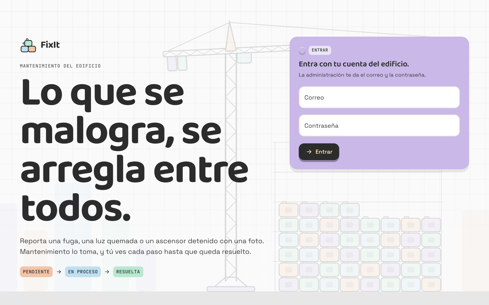
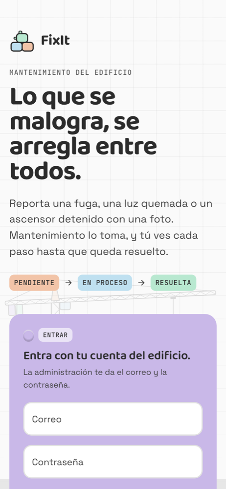
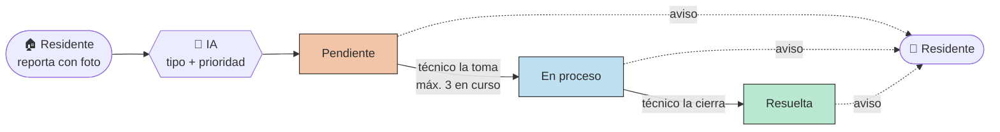
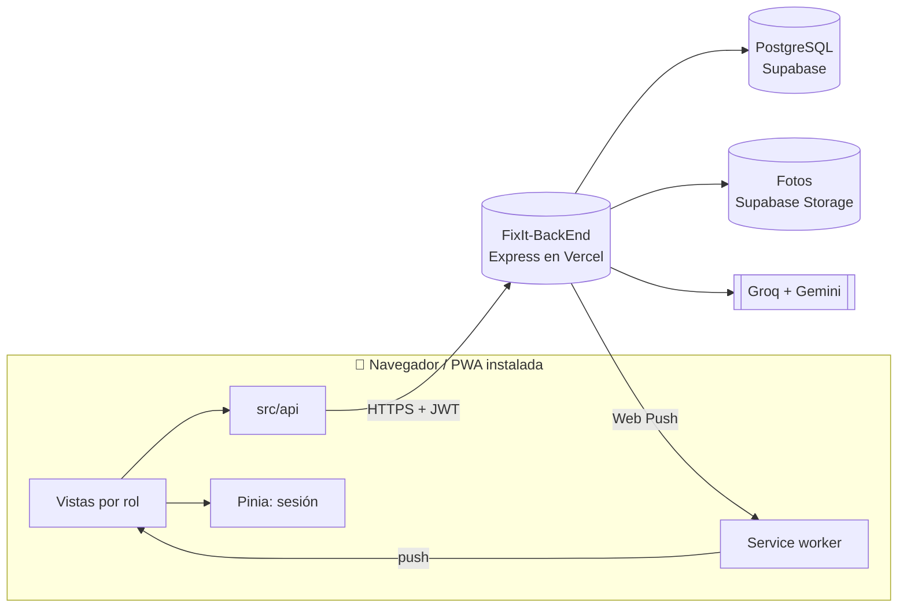

<div align="center">


# FixIt — FrontEnd

**Lo que se malogra, se arregla entre todos.**

Aplicación web para gestionar las incidencias de mantenimiento de edificios residenciales.<br/>
Pensada primero para el celular e instalable como app (PWA).

[](https://github.com/Los-mas-agiles/FixIt-FrontEnd/actions/workflows/ci.yml)


[**Abrir la app**](https://fix-it-front-end-three.vercel.app) ·
[API (Swagger)](https://fix-it-back-end.vercel.app/api/docs) ·
[Repositorio del backend](https://github.com/Los-mas-agiles/FixIt-BackEnd) ·
[Landing page](https://github.com/Los-mas-agiles/FixIt-LandingPage)



</div>

---

## Contenido

- [Qué es FixIt](#qué-es-fixit)
- [Qué puede hacer cada rol](#qué-puede-hacer-cada-rol)
- [Cómo viaja una incidencia](#cómo-viaja-una-incidencia)
- [Arquitectura](#arquitectura)
- [Stack](#stack)
- [Estilo visual: Modular Block City](#estilo-visual-modular-block-city)
- [Puesta en marcha](#puesta-en-marcha)
- [Cómo conectarse al backend](#cómo-conectarse-al-backend)
- [Scripts](#scripts)
- [Estructura](#estructura)
- [Calidad](#calidad)
- [Estado por fases](#estado-por-fases)
- [Documentación](#documentación)
- [Cómo contribuir](#cómo-contribuir)
- [Equipo](#equipo)

## Qué es FixIt

En muchos edificios, los reclamos de mantenimiento se pierden en el chat de los vecinos: nadie sabe quién lo tomó, cuánto falta ni si ya se resolvió. FixIt deja **cada incidencia registrada, clasificada y a la vista de todos**:

- El residente la reporta con una **foto** en segundos.
- Una **IA** le pone el tipo (plomería, electricidad, ascensor…) y la prioridad.
- Mantenimiento la trabaja en un **tablero Kanban** con límite de trabajo en curso.
- El residente ve **cada paso** y recibe un **aviso** cuando cambia.
- La administración mide el servicio con **KPIs ágiles** (cycle time, lead time, WIP, throughput) y el **CFD**.

Proyecto del curso de **Ágiles (1ASI570)** — UPC, Ingeniería de Software, 2026.

## Qué puede hacer cada rol

| | 🏠 Residente | 🔧 Mantenimiento | 📊 Administrador |
|---|:---:|:---:|:---:|
| Reportar una incidencia con foto | ✅ | | |
| Ver el estado de sus incidencias (*stepper*) | ✅ | | |
| Tablero Kanban (tomar y resolver) | | ✅ | ✅ |
| Asignar técnicos | | | ✅ |
| Corregir la clasificación de la IA | | | ✅ |
| Panel de KPIs y gráfico CFD | | | ✅ |
| Gestionar cuentas (crear, desactivar, contraseña temporal) | | | ✅ |
| Avisos en la app y notificaciones push | ✅ | ✅ | ✅ |
| Mi cuenta (cambiar contraseña) | ✅ | ✅ | ✅ |

<p align="center">
  
  <br/><sub>Diseñada primero para el celular.</sub>
</p>

## Cómo viaja una incidencia



El estado solo avanza (pendiente → en proceso → resuelta) y cada cambio queda en el historial, que es lo que alimenta los KPIs y el CFD del panel.

## Arquitectura



- Las vistas **nunca** llaman a `fetch` directamente: todo pasa por `src/api/` y su cliente HTTP.
- El frontend no tiene secretos: toda la seguridad la aplica la API.

## Stack

| | Herramienta | Para qué |
|---|---|---|
| 🧩 | **Vue 3** (Composition API, `<script setup lang="ts">`) + **TypeScript** + **Vite** | Base de la app |
| 🧭 | **Vue Router 4** + **Pinia** | Rutas con *guards* por rol y sesión |
| 🎨 | **Tailwind CSS v4** | Estilos sobre los tokens de la guía |
| 📲 | **vite-plugin-pwa** | App instalable + notificaciones push |
| 📈 | **Chart.js** + **vue-chartjs** | Gráfico CFD |
| 🗜️ | **browser-image-compression** | Comprime la foto en el celular antes de subirla |
| 🧪 | **Vitest** + **Vue Test Utils** | Tests |
| 🚀 | **Vercel** | Despliegue (con *preview* por cada PR) |

## Estilo visual: Modular Block City

La interfaz sigue la guía de estilos **Modular Block City** (la metáfora de una obra que se construye entre vecinos): bloques con radio 20 px, sombra sólida sin blur y un *stud* arriba a la izquierda; pastel sobre casi-blanco; Baloo 2 para titulares, Space Grotesk para texto y JetBrains Mono para datos; un solo easing.

| Archivo | Qué tiene |
|---|---|
| `src/styles/tokens.css`, `base.css`, `components.css`, `motion.css` | Copia de la guía (no editar a mano: si cambia la guía, se vuelven a copiar) |
| `src/styles/app.css` | Piezas propias de FixIt (tablero, campanita, detalle…) hechas solo con los tokens |
| `src/styles/main.css` | Entrada: Tailwind v4 + capas; los tokens también existen como utilidades (`bg-mint`, `font-display`…) |
| `src/lib/blockCity.ts` | Comportamientos de la guía en TypeScript: cascada de entrada, contadores, bloques magnéticos, mini-escenas y el edificio de fondo. El cursor es el del sistema (no usamos la capa de cursor temático) |

**Colores por estado**, siempre acompañados de texto y *stepper* (el color nunca es la única señal):

| Estado | Color | Token |
|---|---|---|
|  | durazno | `--mbc-peach` |
|  | celeste | `--mbc-sky` |
|  | menta | `--mbc-mint` |

La prioridad se muestra con barras de nivel y texto; la **alta** va en tag oscuro (la guía no usa rojo en la interfaz). Con "reducir movimiento" activado en el sistema, se apaga todo lo decorativo.

## Puesta en marcha

**Requisitos:** Node.js 24 (LTS) o superior · VS Code con la extensión **Vue - Official** (recomendado).

```bash
git clone https://github.com/Los-mas-agiles/FixIt-FrontEnd.git
cd FixIt-FrontEnd
npm install
cp .env.example .env
npm run dev          # http://localhost:5173
```

### Variables de entorno

| Variable | Descripción |
|---|---|
| `VITE_API_URL` | URL base de la API, terminada en `/api` |

No hay secretos en el frontend: toda la seguridad la aplica la API.

## Cómo conectarse al backend

El backend ya está desplegado y con datos de demo, **no hace falta correrlo en local**:

```
VITE_API_URL=https://fix-it-back-end.vercel.app/api
```

- **Estado:** listos login y roles, reporte de incidencias con foto, tablero Kanban (cambio de estado, asignación, límite de WIP), clasificación con IA, notificaciones (en la app + push), KPIs y CFD del dashboard, y gestión de cuentas para el piloto (cambio de contraseña, contraseña temporal, desactivar/reactivar).
- **Datos:** Los Olivos ya tiene 12 incidencias en distintos estados, con historial y avisos.
- **Probar la API sin código:** abrir [`docs/PROBAR_API.http`](docs/PROBAR_API.http) con la extensión **REST Client** de VS Code y pulsar "Send Request", o usar el [Swagger](https://fix-it-back-end.vercel.app/api/docs).
- **CORS:** la API acepta `localhost:5173`, `localhost:4173` y `https://fix-it-front-end*.vercel.app`. Al crear el proyecto en Vercel, usar el nombre **`fix-it-front-end`** (o avisar a Edery si es otro).
- **Si algo del backend no calza con el contrato**, avisar a Edery antes de "arreglarlo" en el frontend.

### Cuentas de demo

Todas con la contraseña **`FixIt2026!`** (edificio *Residencial Los Olivos*):

| Rol | Correo |
|---|---|
| 🏠 Residente | `residente1@olivos.demo`, `residente2@olivos.demo` |
| 🔧 Mantenimiento | `tecnico1@olivos.demo`, `tecnico2@olivos.demo` |
| 📊 Administrador | `admin@olivos.demo` |

La tabla completa (con el segundo edificio) está en [`docs/CONTRATO_API.md`](docs/CONTRATO_API.md#3-cuentas-de-demo-las-crea-el-seed-del-backend).

> **¿El login responde "Ocurrió un error"?** Revisar <https://fix-it-back-end.vercel.app/api/health/db>. Si dice que no puede conectarse a la base de datos, el proyecto de Supabase (plan Free) se pausó por inactividad: hay que reanudarlo desde el panel de Supabase.

## Scripts

| Comando | Qué hace |
|---|---|
| `npm run dev` | Servidor de desarrollo |
| `npm run build` | Build de producción (incluye verificación de tipos) |
| `npm run preview` | Sirve el build localmente (para probar la PWA) |
| `npm run typecheck` | Verificación de tipos |
| `npm run lint` | ESLint |
| `npm test` | Tests con Vitest |
| `npm run test:watch` | Tests en modo observador |

## Estructura

```
src/
  api/            # llamadas a la API (una por recurso) + cliente HTTP
  composables/    # lógica reutilizable: carga, polling, push, toasts, acciones
  directives/     # v-tilt (bloques magnéticos)
  lib/            # blockCity.ts: comportamientos de la guía de estilos
  components/     # ui/, incidencia/, layout/, kpis/, usuarios/
  router/         # rutas y guards por rol
  stores/         # sesión (Pinia)
  types/          # tipos del contrato de API
  utils/          # fechas, etiquetas en español
  views/          # pantallas por rol (residente/, admin/ y compartidas)
  styles/         # guía Modular Block City + estilos de FixIt
  sw.ts           # service worker (notificaciones push)
public/icons/     # íconos de la PWA
tests/            # Vitest: utilidades, cliente HTTP y guards
docs/             # guía, contrato de API, plan de fases e imágenes
```

### Pantallas

| Ruta | Pantalla | Quién |
|---|---|---|
| `/login` | Entrar | Todos |
| `/mis-incidencias` | Mis incidencias | Residente |
| `/nueva` | Reportar incidencia | Residente |
| `/incidencias/:id` | Detalle, historial y acciones | Todos (según rol) |
| `/tablero` | Tablero Kanban | Mantenimiento y administrador |
| `/panel` | KPIs y CFD | Administrador |
| `/usuarios` | Gestión de cuentas | Administrador |
| `/cuenta` | Mi cuenta | Todos |

## Calidad

Cada push a `main` y cada Pull Request pasan por **GitHub Actions** ([`ci.yml`](.github/workflows/ci.yml)):

```
npm ci  →  lint  →  typecheck  →  tests  →  build
```

Además, Vercel publica un *preview* de cada PR para revisarlo antes del merge.

## Estado por fases

| Fase | Historia | Estado |
|---|---|:---:|
| 0 | Cimientos (proyecto, layout, cliente HTTP, CI, deploy) | ✅ |
| 1 | HU6 — Login con roles | ✅ |
| 2 | HU1 — Reporte de incidencias con foto | ✅ |
| 3 | HU3 — Tablero Kanban | ✅ |
| 4 | HU2 — Clasificación con IA (badges y corrección manual) | ✅ |
| 5 | HU4 — Notificaciones (PWA + push) | ✅ |
| 6 | HU5 — Dashboard de KPIs y CFD | ✅ |
| 7 | Piloto y cierre (en el front ya está: "Mi cuenta" y la gestión de cuentas en Usuarios) | 🚧 |

## Documentación

| Documento | Contenido |
|---|---|
| [`docs/GUIA_FRONTEND.md`](docs/GUIA_FRONTEND.md) | **Guía para el equipo de frontend**: stack, estructura, pantallas, PWA, reparto de tareas |
| [`docs/CONTRATO_API.md`](docs/CONTRATO_API.md) | Contrato con el backend: tipos, endpoints, errores y cuentas de demo. **Leer antes de programar.** |
| [`docs/PLAN_FASES.md`](docs/PLAN_FASES.md) | Fases de desarrollo, convenciones y Definition of Done |
| [`docs/PROBAR_API.http`](docs/PROBAR_API.http) | Requests listos para probar la API desde VS Code |

> La copia maestra del contrato vive en el repo de backend ([FixIt-BackEnd/docs/CONTRATO_API.md](https://github.com/Los-mas-agiles/FixIt-BackEnd/blob/main/docs/CONTRATO_API.md)). Si difieren, manda la del backend.

## Cómo contribuir

1. Rama desde `main`: `feature/HU<n>-nombre-corto` o `fix/descripcion-corta`.
2. Commits con prefijo: `feat:`, `fix:`, `test:`, `docs:`, `refactor:`, `chore:`.
3. Pull Request pequeño (una pantalla o funcionalidad), con **captura de pantalla** y link del **preview de Vercel**. CI en verde y 1 aprobación para hacer merge.
4. Las vistas nunca llaman a `fetch` directamente: todo pasa por `src/api/`.

## Equipo

**Los más Agiles** — UPC, 2026-2.

| Integrante | Rol |
|---|---|
| George Arturo Aliaga Pimentel | Frontend · Scrum Master |
| Jefrey Martin Sanchez Ignacio | Frontend |
| Edery Renzo Abanto Vicente | Backend, IA y despliegues · Product Owner · QA |

<div align="center">
<sub>Hecho con bloques 🧱 por Los más Agiles · <a href="https://github.com/Los-mas-agiles/FixIt-BackEnd">FixIt-BackEnd</a> · <a href="https://github.com/Los-mas-agiles/FixIt-LandingPage">FixIt-LandingPage</a></sub>
</div>
